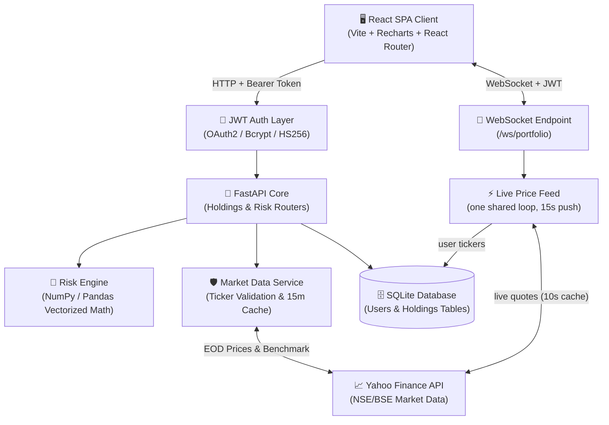
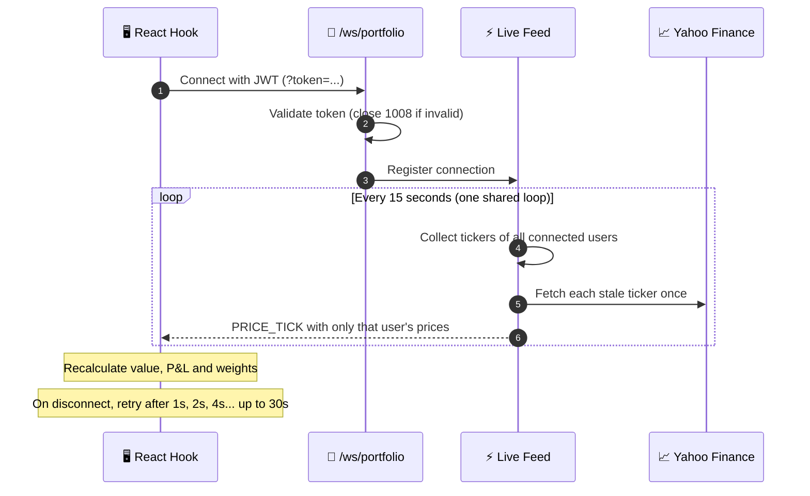

# PortfoliX — Modern Quantitative Portfolio Risk Dashboard

[](https://www.python.org/)
[](https://fastapi.tiangolo.com/)
[](https://jwt.io/)
[](https://fastapi.tiangolo.com/advanced/websockets/)
[](https://react.dev/)
[](https://vitejs.dev/)
[](LICENSE)

**PortfoliX** is a full-stack quantitative portfolio risk analytics platform for Indian stock market investors (NSE/BSE). Standard Indian discount brokers (Zerodha, Upstox, Groww) display basic P&L and day-change metrics, but they do not natively expose portfolio-level risk metrics.

PortfoliX bridges this gap by computing **Annualized Volatility**, **Portfolio Beta (vs. NIFTY 50 `^NSEI`)**, **Annualized Sharpe Ratio**, **Maximum Peak-to-Trough Drawdown**, and **Pairwise Asset Cross-Correlation Matrices** from market data, behind multi-user **JWT Authentication**, with **live portfolio valuation streamed over WebSockets**.

---

## 🌟 Key Features

- **🔐 Multi-User JWT Authentication**:
  - User registration and login (`/auth/register`, `/auth/login`) using the OAuth2 Password Flow.
  - Passwords hashed with `bcrypt` (`passlib`); stateless JWT tokens (`HS256`, 24-hour expiry) authorize all portfolio operations.
  - Per-user data isolation — every holding row belongs to a user, and every query is filtered by the logged-in user.

- **📡 Live Price Streaming (WebSockets)**:
  - JWT-authenticated `/ws/portfolio` endpoint. One shared background loop fetches each ticker once (10-second quote cache) and pushes every connected user only their own holdings' prices every 15 seconds.
  - The React client reconnects automatically with exponential backoff (1s → 30s), sends a periodic heartbeat, and shows a **LIVE / CONNECTING** status badge.
  - The holdings table and summary cards (current value, unrealized P&L, weights) recalculate from live prices. Risk metrics stay on REST because they are computed from historical data.

- **⚡ Smart Ticker Normalization & Validation**:
  - Converts company names and informal terms (e.g. `ADANI POWER` → `ADANIPOWER.NS`, `SBI` → `SBIN.NS`, `TCS` → `TCS.NS`) to exchange tickers.
  - Validates the ticker against the market feed before inserting a holding.
  - Preserves the user's actual cost basis (`buy_price`); it is never overwritten by the market price.

- **📊 Consolidated Portfolio Management**:
  - Consolidates multiple buy lots of the same stock into one row with total quantity, blended average buy price, and a lot badge (e.g. `2 lots`).
  - Manual position entry, one-click **NIFTY 50 Demo Portfolio** loader, ticker autocomplete search, and broker CSV import.
  - Single-ticker deletion and full portfolio reset, with confirmation prompts.

- **📈 Quantitative Risk Analytics**:
  - Value-weighted portfolio volatility, beta against `^NSEI`, Sharpe ratio, and per-stock risk statistics.
  - **Concentration Risk Alert** flags any holding above 30% of total portfolio value.

- **🔗 Pairwise Correlation Heatmap**: daily-returns co-movement between holdings, from -1.0 to +1.0.

- **📉 Historical Drawdown Analysis**: Recharts visualization of the 1-year portfolio drawdown and worst peak-to-trough drop.

- **🧭 Persistent Sidebar Navigation**: multi-page SPA layout using `react-router-dom`.

---

## 📐 Quantitative Financial Formulas

All risk calculations live in `backend/services/risk_engine.py` as pure, stateless functions, using a 252-day trading year and a default risk-free rate of 7.0% (approximate 10-year Indian G-Sec yield):

1. **Daily Returns**:
   $$\text{Return}_t = \frac{P_t - P_{t-1}}{P_{t-1}}$$
2. **Annualized Volatility**:
   $$\sigma_{\text{annual}} = \sigma_{\text{daily}} \times \sqrt{252}$$
3. **Beta ($\beta$) vs NIFTY 50**:
   $$\beta = \frac{\text{Cov}(R_{\text{asset}}, R_{\text{NIFTY}})}{\text{Var}(R_{\text{NIFTY}})}$$
4. **Annualized Sharpe Ratio**:
   $$\text{Sharpe} = \frac{\bar{R}_{\text{annual}} - R_f}{\sigma_{\text{annual}}}$$
5. **Maximum Drawdown (MDD)**:
   $$\text{MDD} = \min_{t} \left( \frac{\text{Cumulative Return}_t - \max_{\tau \le t}(\text{Cumulative Return}_\tau)}{\max_{\tau \le t}(\text{Cumulative Return}_\tau)} \right)$$
6. **Portfolio Value Weights**:
   $$w_i = \frac{\text{Holding Value}_i}{\text{Total Portfolio Value}}$$

---

## 🏗️ System Architecture

PortfoliX uses a decoupled client-server architecture. The React SPA talks to a FastAPI backend over two channels: REST for portfolio data and risk analytics, and a WebSocket for live prices. Both are secured with the same JWT.



### 🔄 Live Price Flow



---

## 📁 Project Structure

```
PortfoliX/
├── backend/
│   ├── main.py                     # FastAPI application entrypoint & CORS
│   ├── auth.py                     # JWT utilities, password hashing & get_current_user dependency
│   ├── database.py                 # SQLite database engine & session maker
│   ├── models.py                   # SQLAlchemy ORM models (User & Holding tables)
│   ├── schemas.py                  # Pydantic request/response schemas
│   ├── routers/
│   │   ├── auth.py                 # Authentication endpoints (/register, /login, /me)
│   │   ├── holdings.py             # CRUD, CSV import, demo loader, search
│   │   ├── risk.py                 # Summary, risk metrics, correlation, drawdown endpoints
│   │   └── ws.py                   # WebSocket endpoint (JWT check on connect)
│   ├── services/
│   │   ├── market_data.py          # Ticker validation, alias mapper & 15m TTL cache
│   │   ├── live_feed.py            # Shared live price broadcaster (10s quote cache)
│   │   └── risk_engine.py          # Pure quantitative math & matrix operations
│   ├── test_risk_engine.py         # Unit tests for pure formulas
│   ├── test_api_endpoints.py       # API integration tests
│   └── requirements.txt
├── frontend/
│   ├── src/
│   │   ├── api/
│   │   │   └── client.js           # Axios API service with auth interceptors
│   │   ├── components/
│   │   │   ├── AllocationPieChart.jsx
│   │   │   ├── ConcentrationBanner.jsx
│   │   │   ├── CorrelationHeatmap.jsx
│   │   │   ├── CsvUploadModal.jsx
│   │   │   ├── DeleteConfirmModal.jsx
│   │   │   ├── DrawdownChart.jsx
│   │   │   ├── EmptyState.jsx
│   │   │   ├── HoldingsFormModal.jsx
│   │   │   ├── HoldingsTable.jsx
│   │   │   ├── LiveBadge.jsx       # LIVE / CONNECTING status indicator
│   │   │   ├── RiskTable.jsx
│   │   │   └── SummaryCards.jsx
│   │   ├── context/
│   │   │   └── PortfolioContext.jsx
│   │   ├── hooks/
│   │   │   └── usePortfolioWebSocket.js  # WebSocket client: auto-reconnect + heartbeat
│   │   ├── layouts/
│   │   │   └── DashboardLayout.jsx # Persistent sidebar navigation layout
│   │   ├── pages/
│   │   │   ├── PortfolioPage.jsx   # /portfolio (holdings & summary, live prices)
│   │   │   ├── RiskPage.jsx        # /risk (risk metrics)
│   │   │   ├── CorrelationPage.jsx # /correlation (heatmap)
│   │   │   └── DrawdownPage.jsx    # /drawdown (drawdown curve)
│   │   ├── App.jsx                 # Route definitions
│   │   ├── main.jsx
│   │   └── index.css               # Design system & dark glassmorphism styling
│   ├── index.html
│   ├── package.json
│   └── vite.config.js
├── pytest.ini
└── README.md
```

---

## 🚀 Quick Start Guide

### Prerequisites
- **Python**: 3.11 or higher
- **Node.js**: 18+ and `npm`

### 1. Backend Setup

```bash
# From the project root
cd PortfoliX

# Create and activate a virtual environment
python -m venv venv

# Windows (PowerShell):
.\venv\Scripts\Activate.ps1
# Windows (CMD):
.\venv\Scripts\activate.bat
# macOS/Linux:
source venv/bin/activate

# Install dependencies
pip install -r backend/requirements.txt
```

#### Secret key

The JWT signing key is read from the `SECRET_KEY` environment variable. If it is not set, the app falls back to a development-only key, so **always set your own before deploying**.

```bash
# Windows (PowerShell)
$env:SECRET_KEY = "your-long-random-secret"

# macOS/Linux
export SECRET_KEY="your-long-random-secret"
```

Start the server:

```bash
uvicorn backend.main:app --host 127.0.0.1 --port 8000 --reload
```

The API runs at `http://127.0.0.1:8000`. Interactive OpenAPI docs are at `http://127.0.0.1:8000/docs`.

### 2. Authentication

Register and log in from the app's UI, or call the API directly:

```bash
# Register
curl -X POST http://127.0.0.1:8000/auth/register \
  -H "Content-Type: application/json" \
  -d '{"email": "investor@example.com", "password": "SecurePassword123!"}'

# Login (OAuth2 form format: the email goes in "username")
curl -X POST http://127.0.0.1:8000/auth/login \
  -H "Content-Type: application/x-www-form-urlencoded" \
  -d "username=investor@example.com&password=SecurePassword123!"
```

The response contains `access_token`. Send it on every protected request:

```text
Authorization: Bearer <your_access_token>
```

### 3. Frontend Setup

```bash
# In a new terminal
cd PortfoliX/frontend
npm install
npm run dev
```

Open `http://localhost:5173`. The frontend talks to `http://localhost:8000` by default; set `VITE_API_URL` to point it elsewhere.

---

## 📡 API Reference

### 🔐 Auth Endpoints
| Method | Endpoint | Authorization | Description |
|---|---|---|---|
| `POST` | `/auth/register` | Public | Register a new user (`email`, `password`) |
| `POST` | `/auth/login` | Public | OAuth2 password login, returns a JWT |
| `GET` | `/auth/me` | Bearer Token | Current authenticated user |

### 📦 Holdings Endpoints
| Method | Endpoint | Authorization | Description |
|---|---|---|---|
| `GET` | `/holdings` | Bearer Token | List all holding lots for the logged-in user |
| `POST` | `/holdings` | Bearer Token | Add a holding (`ticker`, `quantity`, `buy_price`, `buy_date`); validates the ticker first |
| `GET` | `/holdings/search-ticker` | Bearer Token | Search stocks by name or symbol (`?q=ADANI`) |
| `DELETE` | `/holdings/{id}` | Bearer Token | Delete one holding lot by ID |
| `DELETE` | `/holdings/by-ticker/{ticker}` | Bearer Token | Delete all lots for a ticker (e.g. `RELIANCE.NS`) |
| `DELETE` | `/holdings/action/clear-all` | Bearer Token | Delete all holdings for the current user |
| `POST` | `/holdings/import-csv` | Bearer Token | Upload a broker CSV (`Symbol, Quantity, Average Price`) |
| `POST` | `/holdings/demo` | Bearer Token | Load NIFTY 50 demo holdings |

### 🧮 Portfolio Risk Endpoints
| Method | Endpoint | Authorization | Description |
|---|---|---|---|
| `GET` | `/portfolio/summary` | Bearer Token | Consolidated holdings, invested capital, current value, P&L |
| `GET` | `/portfolio/risk` | Bearer Token | Volatility, beta vs NIFTY 50, Sharpe ratio, concentration flags |
| `GET` | `/portfolio/correlation` | Bearer Token | Pairwise returns correlation matrix |
| `GET` | `/portfolio/drawdown` | Bearer Token | 1-year historical drawdown series |

### 📡 WebSocket Endpoint
| Protocol | Endpoint | Authorization | Description |
|---|---|---|---|
| `WS` | `/ws/portfolio?token=<JWT>` | JWT in query string | Streams a `PRICE_TICK` message every 15s with prices for the user's holdings |

Example message:

```json
{
  "type": "PRICE_TICK",
  "timestamp": "2026-10-11T19:25:29.439618+00:00",
  "prices": { "RELIANCE.NS": 1170.3, "TCS.NS": 2156.0 }
}
```

Connections with an invalid or missing token are closed with code `1008`. To try it from a browser console:

```js
const ws = new WebSocket("ws://127.0.0.1:8000/ws/portfolio?token=YOUR_TOKEN");
ws.onmessage = (e) => console.log(e.data);
```

---

## 🧪 Running Automated Tests

```bash
pytest backend/ -v
```

The suite covers the pure risk formulas (volatility, beta, Sharpe, maximum drawdown), portfolio weight integrity, single-asset edge cases, and the API endpoints. The WebSocket endpoint does not have automated tests yet.

---

## 🛡️ Edge Cases & Fixes Handled

- **Strict Ticker Validation**: checks the exchange before adding a holding, so invalid tickers never reach the database.
- **Cost Basis Integrity**: user-entered `buy_price` is never overwritten by the market price.
- **Smart Alias Resolution**: informal inputs like `ADANI POWER` or `SBI` resolve to exchange symbols.
- **User Data Isolation**: every holdings and portfolio query is filtered by the authenticated user.
- **Market Data Fault Tolerance**: dual-layer fetcher (Yahoo Finance chart API with a `yfinance` fallback), 15-minute TTL cache and negative caching for fast failure handling.
- **Stream Resilience**: a failed live price fetch is logged and skipped, keeping the last known price; the client reconnects automatically after network drops.
- **Single-Asset Portfolios**: valid 1×1 correlation matrix and beta without division-by-zero.
- **Malformed CSV Imports**: required headers and numeric values are validated with clear HTTP 400 messages.

---

