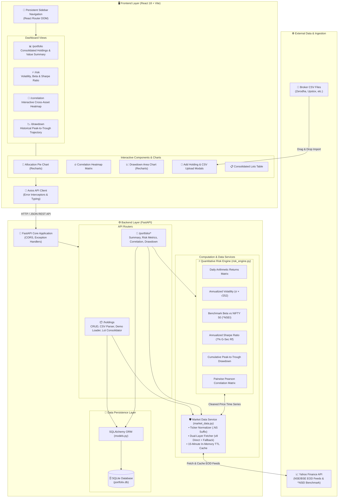
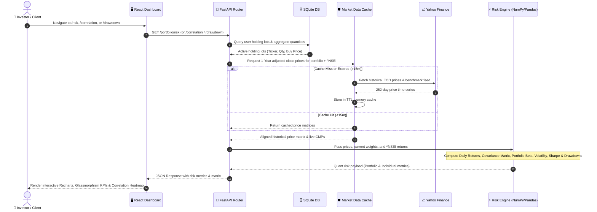

# PortfoliX — Modern Quantitative Portfolio Risk Dashboard

[](https://www.python.org/)
[](https://fastapi.tiangolo.com/)
[](https://react.dev/)
[](https://vitejs.dev/)
[](LICENSE)

**PortfoliX** is a full-stack, institutional-grade quantitative portfolio risk analytics platform tailored for Indian stock market investors (NSE/BSE). While standard Indian discount brokers (Zerodha, Upstox, Groww) display basic P&L and day-change metrics, they do not natively expose portfolio-level risk metrics.

PortfoliX bridges this gap by computing real-time, mathematically rigorous quantitative risk statistics — **Annualized Volatility**, **Portfolio Beta (vs. NIFTY 50 `^NSEI`)**, **Annualized Sharpe Ratio**, **Maximum Peak-to-Trough Drawdown**, and **Pairwise Asset Cross-Correlation Matrices** — using live market data feeds.

---

## 🌟 Key Features

- **📊 Consolidated Portfolio Management**:
  - Automatically consolidates multiple buy lots of the same stock into a single row displaying total quantity, blended average buy price, and a lot badge (e.g. `2 lots`).
  - Supports manual position entry, 1-click **⚡ NIFTY 50 Demo Portfolio** loader, and broker CSV drag-and-drop import.
  - One-click ticker-level deletion with confirmation dialogs.
- **📈 Quantitative Risk Analytics**:
  - Computes value-weighted portfolio volatility, beta against the benchmark `^NSEI` (NIFTY 50), Sharpe ratio, and individual stock risk statistics.
  - **Concentration Risk Alert**: Automatically flags any holding exceeding 30% of total portfolio value.
- **🔗 Pairwise Correlation Heatmap**:
  - Visual matrix displaying daily returns co-movement between holdings from -1.0 to +1.0.
- **📉 Historical Drawdown Analysis**:
  - Interactive Recharts visualization plotting the 1-year historical portfolio drawdown trajectory and worst peak-to-trough drop.
- **🧭 Persistent Sidebar Navigation**:
  - Modern, responsive SPA layout with continuous multi-page routing via `react-router-dom`.

---

## 📐 Quantitative Financial Formulas

All mathematical computations are executed inside `backend/services/risk_engine.py` as pure, stateless functions using a 252-day annual trading calendar and a default risk-free rate of 7.0% (approximate 10-year Indian Government Bond / G-Sec yield):

1. **Daily Log / Arithmetic Returns**:
   $$\text{Return}_t = \frac{P_t - P_{t-1}}{P_{t-1}}$$
2. **Annualized Volatility**:
   $$\sigma_{\text{annual}} = \sigma_{\text{daily}} \times \sqrt{252}$$
3. **Beta ($\beta$) vs NIFTY 50**:
   $$\beta = \frac{\text{Cov}(R_{\text{asset}}, R_{\text{NIFTY}})}{\text{Var}(R_{\text{NIFTY}})}$$
4. **Annualized Sharpe Ratio**:
   $$\text{Sharpe} = \frac{\bar{R}_{\text{annual}} - R_f}{\sigma_{\text{annual}}}$$
5. **Maximum Drawdown (MDD)**:
   $$\text{MDD} = \min_{t} \left( \frac{\text{Cumulative Return}_t - \max_{\tau \le t}(\text{Cumulative Return}_\tau)}{\max_{\tau \le t}(\text{Cumulative Return}_\tau)} \right)$$
6. **Portfolio Value Weights**:
   $$w_i = \frac{\text{Holding Value}_i}{\text{Total Portfolio Value}}$$

---

## 🏗️ System Architecture

PortfoliX is built with a decoupled client-server architecture featuring a React SPA frontend, a FastAPI micro-backend, a vectorized quantitative finance engine, and a resilient market data caching pipeline.

### 📐 High-Level Architecture Diagram



---

### 🔄 End-to-End Data & Calculation Flow



---

### 📁 Project Structure

```
PortfoliX/
├── backend/
│   ├── main.py                     # FastAPI application entrypoint & CORS
│   ├── database.py                 # SQLite database engine & session maker
│   ├── models.py                   # SQLAlchemy ORM models (Holding table)
│   ├── schemas.py                  # Pydantic request/response schemas
│   ├── routers/
│   │   ├── holdings.py             # CRUD, CSV import, demo loader, ticker deletion
│   │   └── risk.py                 # Summary, risk, correlation, drawdown endpoints
│   ├── services/
│   │   ├── market_data.py          # Yahoo Finance v8 direct API + fallback with 15m TTL cache
│   │   └── risk_engine.py          # Pure quantitative math & matrix operations
│   ├── test_risk_engine.py         # Unit tests for pure formulas
│   ├── test_api_endpoints.py       # API integration tests
│   └── requirements.txt
├── frontend/
│   ├── src/
│   │   ├── api/
│   │   │   └── client.js           # Axios API service
│   │   ├── components/
│   │   │   ├── AllocationPieChart.jsx
│   │   │   ├── ConcentrationBanner.jsx
│   │   │   ├── CorrelationHeatmap.jsx
│   │   │   ├── CsvUploadModal.jsx
│   │   │   ├── DeleteConfirmModal.jsx
│   │   │   ├── DrawdownChart.jsx
│   │   │   ├── EmptyState.jsx
│   │   │   ├── HoldingsFormModal.jsx
│   │   │   ├── HoldingsTable.jsx
│   │   │   ├── RiskTable.jsx
│   │   │   └── SummaryCards.jsx
│   │   ├── layouts/
│   │   │   └── DashboardLayout.jsx # Persistent Sidebar navigation layout
│   │   ├── pages/
│   │   │   ├── PortfolioPage.jsx   # /portfolio (Holdings & Summary)
│   │   │   ├── RiskPage.jsx        # /risk (Risk Metrics)
│   │   │   ├── CorrelationPage.jsx # /correlation (Heatmap)
│   │   │   └── DrawdownPage.jsx    # /drawdown (Drawdown Curve)
│   │   ├── App.jsx                 # Route definitions
│   │   ├── main.jsx
│   │   └── index.css               # Design system & dark glassmorphism styling
│   ├── index.html
│   ├── package.json
│   └── vite.config.js
└── README.md
```

---

## 🚀 Quick Start Guide

### Prerequisites
- **Python**: 3.11 or higher
- **Node.js**: 18+ and `npm`

### 1. Backend Setup

```bash
# Navigate to the project root
cd PortfoliX

# (Optional) Create and activate a virtual environment
python -m venv venv
# On Windows:
.\venv\Scripts\activate
# On macOS/Linux:
source venv/bin/activate

# Install dependencies
pip install -r backend/requirements.txt

# Run the FastAPI server
uvicorn backend.main:app --host 127.0.0.1 --port 8000 --reload
```
The backend API will be running at `http://127.0.0.1:8000`. Interactive OpenAPI documentation is accessible at `http://127.0.0.1:8000/docs`.

---

### 2. Frontend Setup

```bash
# In a new terminal, navigate to the frontend directory
cd PortfoliX/frontend

# Install dependencies
npm install

# Start the Vite development server
npm run dev
```
Open your browser and navigate to `http://localhost:5173`.

---

## 📡 REST API Reference

| Method | Endpoint | Description |
|---|---|---|
| `GET` | `/` | API status and health check |
| `GET` | `/holdings` | List all individual holding lots |
| `POST` | `/holdings` | Add a new holding lot (`ticker`, `quantity`, `buy_price`, `buy_date`) |
| `DELETE` | `/holdings/{id}` | Delete a single holding lot by ID |
| `DELETE` | `/holdings/by-ticker/{ticker}` | Delete all lots matching a ticker (e.g. `RELIANCE.NS`) |
| `POST` | `/holdings/import-csv` | Upload broker export CSV (`Symbol, Quantity, Average Price`) |
| `POST` | `/holdings/demo` | Pre-load standard NIFTY 50 demo holdings |
| `GET` | `/portfolio/summary` | Consolidated holdings, invested capital, current valuation, and P&L |
| `GET` | `/portfolio/risk` | Portfolio & per-stock volatility, beta, Sharpe ratio, and concentration warnings |
| `GET` | `/portfolio/correlation` | Pairwise correlation matrix of holding returns |
| `GET` | `/portfolio/drawdown` | Historical 1-year portfolio drawdown time series |

---

## 🧪 Running Automated Tests

Run the full test suite (pure math unit tests + API integration tests):

```bash
pytest backend/ -v
```

All 14 tests validate:
- Zero volatility on constant price streams.
- Accurate beta calculation against self ($\beta = 1.0$) and synthetic market data.
- Hand-calculated maximum drawdown verification.
- Value weight sum integrity ($\sum w_i = 1.0$).
- Single-holding edge cases and CSV validation error handling.

---

## 🛡️ Edge Cases Handled

- **Empty Portfolio**: Returns HTTP 404 with helpful error messages and displays smooth empty state UI.
- **Ticker Formatting**: Automatically normalizes Indian equity symbols without suffix to `.NS` (e.g. `TCS` $\to$ `TCS.NS`).
- **Resilient Market Data Fetcher**: Dual-layer Yahoo Finance v8 direct chart API queries with fallback, plus a 15-minute in-memory cache to prevent rate-limiting.
- **Single-Asset Portfolios**: Computes valid $1 \times 1$ correlation matrix and beta without division-by-zero crashes.
- **Malformed CSV Imports**: Gracefully validates column names and numeric values with clear HTTP 400 rejection responses.

---

## 📌 Known Limitations & Roadmap

- **Market Data Feed**: Uses Yahoo Finance public endpoints; production enterprise deployments should integrate with direct broker APIs (e.g. Zerodha Kite Connect, Upstox API).
- **Intraday Data**: Metrics are calculated using daily closing prices over a 1-year lookback period.
- **Single User / Local DB**: Configured for local single-user SQLite storage.
- **Future Roadmap**:
  - Multi-broker CSV parsers (Groww, AngelOne, ICICI Direct).
  - Monte Carlo future value simulations.
  - "What-If" portfolio rebalancing and trade simulator.
  - Sector-wise exposure breakdown.
