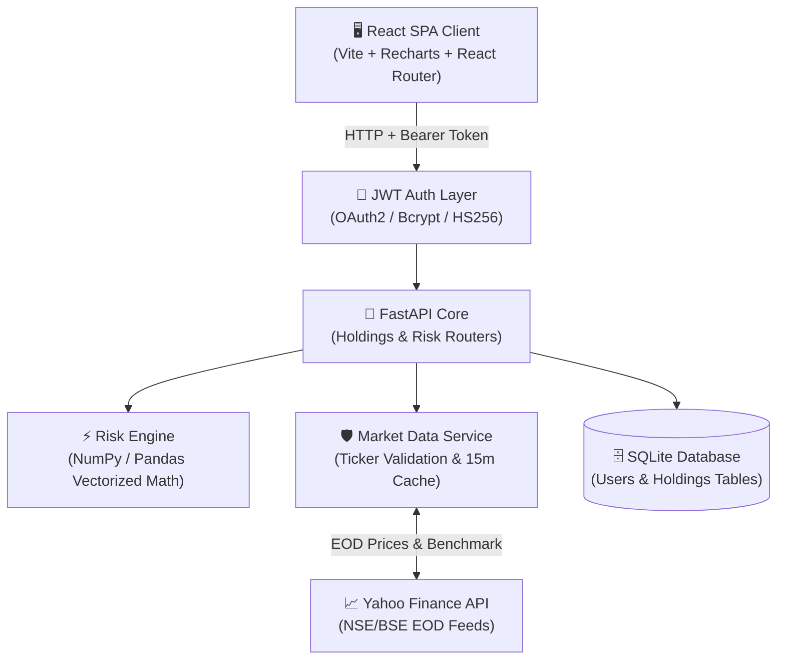

# PortfoliX — Modern Quantitative Portfolio Risk Dashboard

[](https://www.python.org/)
[](https://fastapi.tiangolo.com/)
[](https://jwt.io/)
[](https://react.dev/)
[](https://vitejs.dev/)
[](LICENSE)

**PortfoliX** is a full-stack, institutional-grade quantitative portfolio risk analytics platform tailored for Indian stock market investors (NSE/BSE). While standard Indian discount brokers (Zerodha, Upstox, Groww) display basic P&L and day-change metrics, they do not natively expose portfolio-level risk metrics.

PortfoliX bridges this gap by computing real-time, mathematically rigorous quantitative risk statistics — **Annualized Volatility**, **Portfolio Beta (vs. NIFTY 50 `^NSEI`)**, **Annualized Sharpe Ratio**, **Maximum Peak-to-Trough Drawdown**, and **Pairwise Asset Cross-Correlation Matrices** — using live market data feeds backed by multi-tenant **JWT Authentication** and **Smart Ticker Validation**.

---

## 🌟 Key Features

- **🔐 Multi-Tenant JWT Authentication**:
  - Secure user registration and login (`/auth/register`, `/auth/login`) using OAuth2 Password Flow.
  - Passwords hashed with `bcrypt` (`passlib`); stateless JWT tokens (`HS256`, 24-hour expiration) authorize all portfolio operations.
  - Complete user isolation — each user's holdings and risk statistics are stored and computed independently.

- **⚡ Smart Ticker Normalization & Validation**:
  - **Auto-Resolution & Alias Mapping**: Converts company names, abbreviations, or informal search terms (e.g. `ADANI POWER` $\to$ `ADANIPOWER.NS`, `SBI` $\to$ `SBIN.NS`, `TCS` $\to$ `TCS.NS`) to official exchange tickers.
  - **Pre-Insertion Exchange Validation**: Queries market feeds before adding holdings to prevent invalid or non-existent tickers from corrupting portfolio calculations.
  - **Purchase Price Integrity**: Strictly preserves the user's actual cost basis (`buy_price`), preventing accidental overwriting by current market price (CMP).

- **📊 Consolidated Portfolio Management**:
  - Automatically consolidates multiple buy lots of the same stock into a single view showing total quantity, blended average buy price, and a lot badge (e.g. `2 lots`).
  - Supports manual position entry, 1-click **⚡ NIFTY 50 Demo Portfolio** loader, live ticker autocomplete search, and broker CSV drag-and-drop import.
  - Supports single-lot deletion and full ticker-level liquidation with confirmation modals.

- **📈 Quantitative Risk Analytics**:
  - Computes value-weighted portfolio volatility, beta against the benchmark `^NSEI` (NIFTY 50), Sharpe ratio, and individual stock risk statistics.
  - **Concentration Risk Alert**: Automatically flags any holding exceeding 30% of total portfolio value.

- **🔗 Pairwise Correlation Heatmap**:
  - Visual matrix displaying daily returns co-movement between holdings from -1.0 to +1.0.

- **📉 Historical Drawdown Analysis**:
  - Interactive Recharts visualization plotting the 1-year historical portfolio drawdown trajectory and worst peak-to-trough drop.

- **🧭 Persistent Sidebar Navigation**:
  - Modern, responsive SPA layout with continuous multi-page routing via `react-router-dom`.

---

## 📐 Quantitative Financial Formulas

All mathematical computations are executed inside `backend/services/risk_engine.py` as pure, stateless functions using a 252-day annual trading calendar and a default risk-free rate of 7.0% (approximate 10-year Indian Government Bond / G-Sec yield):

1. **Daily Log / Arithmetic Returns**:
   $$\text{Return}_t = \frac{P_t - P_{t-1}}{P_{t-1}}$$
2. **Annualized Volatility**:
   $$\sigma_{\text{annual}} = \sigma_{\text{daily}} \times \sqrt{252}$$
3. **Beta ($\beta$) vs NIFTY 50**:
   $$\beta = \frac{\text{Cov}(R_{\text{asset}}, R_{\text{NIFTY}})}{\text{Var}(R_{\text{NIFTY}})}$$
4. **Annualized Sharpe Ratio**:
   $$\text{Sharpe} = \frac{\bar{R}_{\text{annual}} - R_f}{\sigma_{\text{annual}}}$$
5. **Maximum Drawdown (MDD)**:
   $$\text{MDD} = \min_{t} \left( \frac{\text{Cumulative Return}_t - \max_{\tau \le t}(\text{Cumulative Return}_\tau)}{\max_{\tau \le t}(\text{Cumulative Return}_\tau)} \right)$$
6. **Portfolio Value Weights**:
   $$w_i = \frac{\text{Holding Value}_i}{\text{Total Portfolio Value}}$$

---

## 🏗️ System Architecture

PortfoliX uses a decoupled client-server architecture. The frontend React SPA communicates with a FastAPI microservice secured by JWT Bearer authentication, backed by a vectorized quantitative finance engine, market data cache, and SQLite persistence.



---

## 📁 Project Structure

```
PortfoliX/
├── backend/
│   ├── main.py                     # FastAPI application entrypoint & CORS
│   ├── auth.py                     # JWT utilities, password hashing & get_current_user dependency
│   ├── database.py                 # SQLite database engine & session maker
│   ├── models.py                   # SQLAlchemy ORM models (User & Holding tables)
│   ├── schemas.py                  # Pydantic request/response schemas
│   ├── routers/
│   │   ├── auth.py                 # Authentication endpoints (/register, /login, /me)
│   │   ├── holdings.py             # CRUD, CSV import, demo loader, search, lot consolidator
│   │   └── risk.py                 # Summary, risk metrics, correlation, drawdown endpoints
│   ├── services/
│   │   ├── market_data.py          # Exchange ticker validation, alias mapper & 15m TTL cache
│   │   └── risk_engine.py          # Pure quantitative math & matrix operations
│   ├── test_risk_engine.py         # Unit tests for pure formulas
│   ├── test_api_endpoints.py       # API & Auth integration tests
│   └── requirements.txt
├── frontend/
│   ├── src/
│   │   ├── api/
│   │   │   └── client.js           # Axios API service with Auth interceptors
│   │   ├── components/
│   │   │   ├── AllocationPieChart.jsx
│   │   │   ├── ConcentrationBanner.jsx
│   │   │   ├── CorrelationHeatmap.jsx
│   │   │   ├── CsvUploadModal.jsx
│   │   │   ├── DeleteConfirmModal.jsx
│   │   │   ├── DrawdownChart.jsx
│   │   │   ├── EmptyState.jsx
│   │   │   ├── HoldingsFormModal.jsx
│   │   │   ├── HoldingsTable.jsx
│   │   │   ├── RiskTable.jsx
│   │   │   └── SummaryCards.jsx
│   │   ├── layouts/
│   │   │   └── DashboardLayout.jsx # Persistent Sidebar navigation layout
│   │   ├── pages/
│   │   │   ├── PortfolioPage.jsx   # /portfolio (Holdings & Summary)
│   │   │   ├── RiskPage.jsx        # /risk (Risk Metrics)
│   │   │   ├── CorrelationPage.jsx # /correlation (Heatmap)
│   │   │   └── DrawdownPage.jsx    # /drawdown (Drawdown Curve)
│   │   ├── App.jsx                 # Route definitions
│   │   ├── main.jsx
│   │   └── index.css               # Design system & dark glassmorphism styling
│   ├── index.html
│   ├── package.json
│   └── vite.config.js
└── README.md
```

---

## 🚀 Quick Start Guide

### Prerequisites
- **Python**: 3.11 or higher
- **Node.js**: 18+ and `npm`

---

### 1. Backend Setup

```bash
# Navigate to the project root
cd PortfoliX

# Create and activate a virtual environment
python -m venv venv

# On Windows (PowerShell):
.\venv\Scripts\Activate.ps1
# On Windows (CMD):
.\venv\Scripts\activate.bat
# On macOS/Linux:
source venv/bin/activate

# Install dependencies
pip install -r backend/requirements.txt
```

#### Environment Configuration
Create a `.env` file in the project root:

```env
SECRET_KEY=your-custom-secure-secret-key-here
```
> **Note**: If `SECRET_KEY` is not set, a development fallback key is used. Set a strong secret key for production environments.

Launch the server:

```bash
uvicorn backend.main:app --host 127.0.0.1 --port 8000 --reload
```
The API will run at `http://127.0.0.1:8000`. Interactive OpenAPI documentation is accessible at `http://127.0.0.1:8000/docs`.

---

### 2. User Authentication & Token Retrieval

PortfoliX requires a valid JWT token for protected portfolio operations.

#### Register a New User
```bash
curl -X POST http://127.0.0.1:8000/auth/register \
  -H "Content-Type: application/json" \
  -d '{"email": "investor@example.com", "password": "SecurePassword123!"}'
```

#### Login & Obtain Access Token
```bash
curl -X POST http://127.0.0.1:8000/auth/login \
  -H "Content-Type: application/x-www-form-urlencoded" \
  -d "username=investor@example.com&password=SecurePassword123!"
```
*Response:*
```json
{
  "access_token": "eyJhbGciOiJIUzI1NiIsInR5cCI6...",
  "token_type": "bearer"
}
```

Include the returned token in the `Authorization` header for subsequent API calls:
```text
Authorization: Bearer <your_access_token>
```

---

### 3. Frontend Setup

```bash
# Open a new terminal and navigate to frontend
cd PortfoliX/frontend

# Install dependencies
npm install

# Start the Vite dev server
npm run dev
```
Open your browser and navigate to `http://localhost:5173`.

---

## 📡 REST API Reference

### 🔐 Auth Endpoints
| Method | Endpoint | Authorization | Description |
|---|---|---|---|
| `POST` | `/auth/register` | Public | Register a new user (`email`, `password`) |
| `POST` | `/auth/login` | Public | OAuth2 password login, returns JWT token |
| `GET` | `/auth/me` | Bearer Token | Get current authenticated user details |

### 📦 Holdings Endpoints
| Method | Endpoint | Authorization | Description |
|---|---|---|---|
| `GET` | `/holdings` | Bearer Token | List all holding lots for logged-in user |
| `POST` | `/holdings` | Bearer Token | Add holding (`ticker`, `quantity`, `buy_price`, `buy_date`). Pre-validates ticker on exchange. |
| `GET` | `/holdings/search-ticker` | Bearer Token | Search Indian & global stocks (`?q=ADANI`) with exchange metadata |
| `DELETE` | `/holdings/{id}` | Bearer Token | Delete a specific holding lot by ID |
| `DELETE` | `/holdings/by-ticker/{ticker}` | Bearer Token | Delete all lots for a ticker (e.g. `RELIANCE.NS`) |
| `DELETE` | `/holdings/action/clear-all` | Bearer Token | Delete all holdings for current user |
| `POST` | `/holdings/import-csv` | Bearer Token | Upload broker CSV (`Symbol, Quantity, Average Price`) |
| `POST` | `/holdings/demo` | Bearer Token | Load standard NIFTY 50 demo holdings for testing |

### 🧮 Portfolio Risk Endpoints
| Method | Endpoint | Authorization | Description |
|---|---|---|---|
| `GET` | `/portfolio/summary` | Bearer Token | Consolidated portfolio values, total cost, CMP valuation, P&L |
| `GET` | `/portfolio/risk` | Bearer Token | Volatility, Beta vs NIFTY 50, Sharpe Ratio, concentration flags |
| `GET` | `/portfolio/correlation` | Bearer Token | Pairwise returns correlation matrix |
| `GET` | `/portfolio/drawdown` | Bearer Token | 1-year historical drawdown time series |

---

## 🧪 Running Automated Tests

Run the full automated test suite covering unit math and API integration:

```bash
pytest backend/ -v
```

Tests validate:
- User registration, login, password hashing, and JWT authorization enforcement.
- Ticker validation, alias resolution, and invalid ticker rejection (HTTP 400).
- Pure mathematical formulas (volatility, beta, Sharpe ratio, maximum drawdown).
- Portfolio weight sum integrity ($\sum w_i = 1.0$) and single-asset edge cases.
- Broker CSV parser error handling and edge cases.

---

## 🛡️ Edge Cases & Fixes Handled

- **Strict Ticker Validation**: Pre-checks exchange presence before adding holdings to prevent invalid or misformatted tickers from entering the database.
- **Cost Basis Integrity**: User-entered `buy_price` is strictly preserved and never overwritten by current market price (CMP).
- **Smart Alias Resolution**: Converts informal inputs like `ADANI POWER` or `SBI` into official exchange symbols (`ADANIPOWER.NS`, `SBIN.NS`).
- **User Data Isolation**: JWT middleware guarantees that each user can only view, add, or delete their own portfolio positions.
- **Market Data Fault Tolerance**: Dual-layer fetcher (Yahoo Finance chart API + `yfinance` fallback) with 15-minute TTL caching and negative caching for rapid failure handling.
- **Single-Asset Portfolios**: Computes valid $1 \times 1$ correlation matrix and beta without division-by-zero errors.
- **Malformed CSV Imports**: Gracefully validates required headers and numeric values with helpful HTTP 400 messages.

---

## 💻 Contributing – Backend Guidelines

When contributing to the backend:

1. **Authentication Enforcement**: Ensure all new endpoints in portfolio routers pass `current_user: User = Depends(get_current_user)` to guarantee multi-tenant security.
2. **Ticker Handling**: Use `normalize_ticker()` and `fetch_single_ticker_data()` from `backend.services.market_data` when handling input stock symbols.
3. **Environment Security**: Never commit secret keys to version control. Use `.env` or set `SECRET_KEY` in environment variables.
4. **Testing**: Add corresponding test cases in `backend/test_api_endpoints.py` for new API routes or edge cases, and run `pytest backend/ -v` before submitting pull requests.

---

## 📌 Known Limitations & Roadmap

- **Broker API Integration**: Uses Yahoo Finance market data feeds; production enterprise setups can integrate directly with Zerodha Kite Connect or Upstox API.
- **Historical Horizon**: Calculates risk statistics over a 1-year lookback period using daily closing prices.
- **Future Roadmap**:
  - Social OAuth2 login (Google/GitHub).
  - Multi-broker CSV parsers (Groww, AngelOne, ICICI Direct).
  - Monte Carlo portfolio value simulations.
  - "What-If" portfolio rebalancing and trade simulator.
  - Sector-wise and market-cap exposure breakdown.
